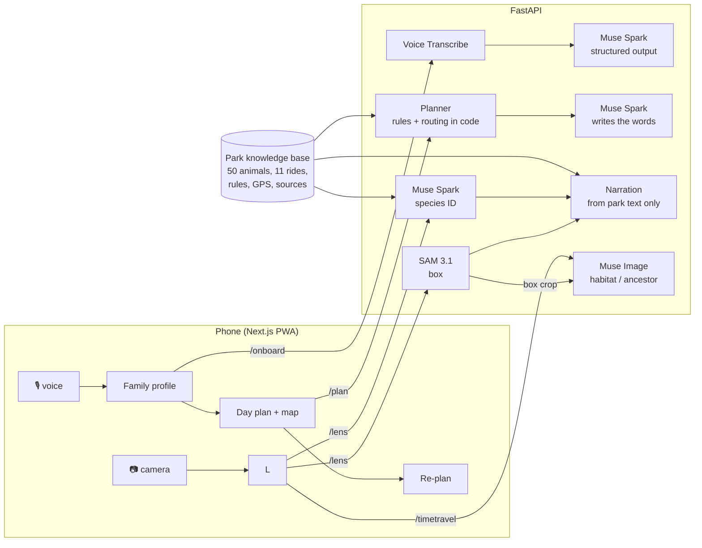

# ParkLens

A personalized, multimodal guide for wildlife and theme parks, built for the
Meta Global AI Developer Hackathon (Indie track). Demo park: Kolmården, Sweden.
Unofficial prototype; not affiliated with or endorsed by Kolmården.

- Say who's visiting (kids' ages and heights, interests, time) and get a day plan that
  respects ride height rules.
- Point the camera at an enclosure: SAM 3.1 finds the animal, Muse Spark tells its story
  from the park's own facts, and Muse Image shows it in its wild habitat or as its
  prehistoric ancestor.
- The plan adapts during the day as you go.

**Demo video (1:43):** [docs/demo/parklens-demo.mp4](https://github.com/akhilsplendid/parklens/raw/main/docs/demo/parklens-demo.mp4)
· **Thread on X:** [the tiger, a million years ago](https://x.com/akhilsplendid/status/2118113529282633857)

## How it uses Meta's models

| Step | Model | Endpoint |
|---|---|---|
| Voice onboarding, re-plan by voice | `muse-voice-transcribe-1.0` | `/v1/asr/transcribe` |
| Party profile, species ID, narration | `muse-spark-1.3` (structured output) | `/v1/chat/completions` |
| Find the animal in the frame | `sam-3.1` | `/v1/responses` (streamed) |
| Habitat / ancestor image | `muse-image-1.0` | `/v1/images/edits` |



Hard rules (height, age, time) are enforced in code (`api/parklens/services/rules.py`);
the model only writes the words. Every narration is grounded in the park's own page and
returns its `source_url`.

Why not let the model plan? On the TravelPlanner benchmark (Xie et al., ICML 2024) GPT-4
satisfied every constraint in 0.6% of plans. A family day is that kind of problem: heights
against ride minimums, a time budget, walking distances, breaks. So the planner is plain code
and Muse Spark is asked afterwards for one sentence per stop. The Lens is not retrieval
either: Spark picks an id from a closed catalogue of the park's species (or `none`), code looks
up the facts, and anything not on the list is refused with a source-free "not one of
Kolmården's listed species".

What is computed: eligibility, route, times, sources. What is generated: words and pictures.

The API rate-limits per IP, caps uploads, honours EXIF rotation, and turns model hiccups
into 4xx/503s with a one-shot retry (`api/parklens/main.py`, `meta_client.py`).

## Quick start (Windows, PowerShell)

```powershell
copy .env.example .env               # then put your MODEL_API_KEY in .env
python scripts\extract_kb.py         # builds data\generated\kb.json from the local crawl (optional:
                                     # without it the API boots on the committed data\kb.sample.json)
python scripts\smoke_test.py         # one real call: lists models, grounded tiger answer
cd api
uv venv; .venv\Scripts\activate
uv pip install -e ".[dev]"
pytest -q                            # 28 tests, no network needed
uvicorn parklens.main:app --reload   # http://127.0.0.1:8000/docs
```

Or with Docker: `docker compose up --build`.

## API

| Route | What it does |
|---|---|
| `GET /health` | KB loaded? |
| `GET /kb/items?kind=animal` | the park's animals / attractions with rules and sources |
| `POST /onboard/text` `{text}` | spoken/typed description → `Party` |
| `POST /onboard/voice` (audio file) | transcript + `Party` |
| `POST /plan` (`Party`) | day plan; rides the kids can't ride land in `skipped` with the reason |
| `POST /plan/replan` `{plan, utterance, now, done_ids, here_id}` | "we're tired, one hour left" / "more rides" → new plan from where you stand |
| `GET /kb/map` | entrance and bounds for the schematic park map |
| `POST /lens` (image, party?, expected?, language?) | box + species + narration + source |
| `POST /lens/warm` `{party, species_ids}` | pre-generate narration for today's animals |
| `POST /transcribe` (audio file) | speech → text |
| `POST /timetravel` (image, mode=wild/ancestor/future, species_id, box) | AI artistic image of the boxed animal |
| `POST /events` `{name, props}` | anonymous usage counter (local JSONL; no ids, text or images) |

## Layout

```
api/parklens/        FastAPI app, Meta client, SAM parser, geo, services (lens, planner, rules, ...)
api/tests/           pytest suite with a fake Meta client
web/                 Next.js PWA: family, plan, map, lens
scripts/extract_kb.py  builds the knowledge base from a local crawl of the park site
docs/PLAN.md         architecture, schedule, demo outline
```

## Data

Park facts come from a public, robots.txt-permitted crawl made before the hackathon.
That crawl and the generated knowledge base are not committed; only the extraction
script is. `data/kb.sample.json` is a small hand-written stand-in (12 places, paraphrased
facts, real rule texts and coordinates) so a fresh clone runs end to end. Every fact keeps its source URL. All application code was written during the
hackathon (Oct 27 – Nov 4, 2026).
